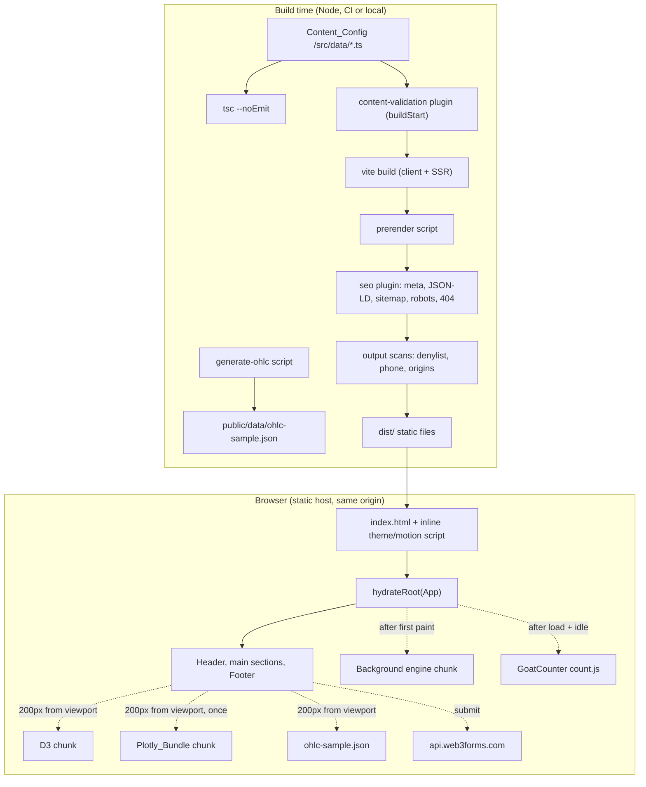
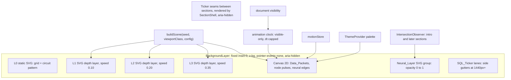
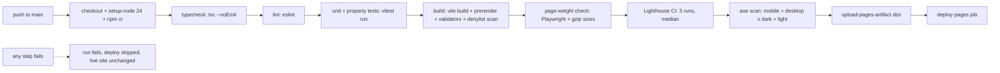

# Design Document: portfolio-website

## Overview

This design turns the 32 requirements in `requirements.md` into a buildable architecture for a single-page, 100% static portfolio for Aishvarya Ramesh. It is a React + TypeScript + Vite SPA, prerendered to static HTML at build time, served from GitHub Pages at the Site_Origin `https://aishvaryaramesh08.github.io` with Vite `base: "/"` (Req 1, 2).

Guiding decisions:

| # | Decision | Rationale | Reqs |
|---|----------|-----------|------|
| D1 | **Build-time prerender + hydrate.** A post-build script renders the React tree to `dist/index.html` with `react-dom/server`, then the client calls `hydrateRoot`. No runtime server. | Hook/Intro text, section IDs and headings exist in the HTML before JS runs (SEO, LCP, no-JS visibility). | 1.1, 3.3, 29.7, 30.4 |
| D2 | **Final state is the default DOM state.** Every animation is a `from` animation applied by JS; CSS hides pre-animation states only under `html.js:not([data-motion=reduced])`, with an inline fail-safe that removes `js` if hydration never happens. | Reduced motion, failed scripts and failed reveals all degrade to fully visible content. | 23.6, 26.1, 29.7 |
| D3 | **One motion source of truth.** A `motionStore` (matchMedia listener + `useSyncExternalStore`) drives Framer Motion (`MotionConfig`), GSAP contexts, canvas engines, CSS (`html[data-motion]`) and timers. | Live switching within 1 s without reload. | 6.14, 23.8, 26.4, 26.5 |
| D4 | **Framer Motion for component UI motion; GSAP + ScrollTrigger only for scroll-linked storytelling and programmatic scrolling.** | Clear ownership, no double-driving of the same element. | 1.2 |
| D5 | **Pure logic in `src/lib`, rendering in components.** Graph reachability, OHLC generation, journey mapping, terminal commands, highlight sets, scroll math and validators are pure TypeScript functions. | Makes the requirement properties directly property-testable with fast-check. | 13.4, 15.9–15.12, 17.6, 19.9, 24.5 |
| D6 | **Typed Content_Config + build-time validators** run as a Vite plugin (`buildStart` for content, `closeBundle` for output scans). | Bad content fails `vite build` locally and in CI with file/field-level messages. | 4, 8.5, 13.2, 14.16, 19.10, 31.4 |
| D7 | **Custom SVG + 2D canvas background**, engine loaded after first paint, isolated by an error boundary. | No tsparticles; zero cost to LCP; failure leaves a blank background. | 1.3, 6 |
| D8 | **Lazy, memoized library loaders**: D3 modules and a single Plotly partial bundle (`plotly.js/lib/core` + candlestick) loaded at most once per page view. | Keeps Initial_Page_Weight < 3 MB and Plotly requested once. | 13.8, 15.5, 19.23, 30.2, 30.10 |
| D9 | **Inline Case_Study expansion** (disclosure pattern) rather than modals. | Simpler focus model on mobile, natural host for the Dependency_Demo; Req 12.2 allows either. Dialog-based focus traps are used for the Mobile_Menu and the two lightboxes. | 12.2, 12.6, 28.4 |
| D10 | **No Three.js in the initial scope.** A `LazyVisibleChunk` slot with 1-viewport preload distance and error boundary is defined so it can be added later without breaking Req 1.4/1.7. | Keeps initial bundle small. | 1.3, 1.4, 1.7 |

Research notes that shaped the design:

- Plotly.js partial bundles: the scatter trace is part of every bundle, and custom bundles can include just the traces you need ([plotly.js CUSTOM_BUNDLE.md](https://github.com/plotly/plotly.js/blob/master/CUSTOM_BUNDLE.md)). The prebuilt `plotly.js-finance-dist-min` contains scatter, candlestick and several finance traces ([npm](https://npmjs.com/package/plotly.js-finance-dist-min)); `plotly.js-basic-dist-min` has no candlestick, so it cannot serve the Live_Chart_Demo alone. Plotly.js 4.x requires Node 22+ for source builds ([migration guide](https://plotly.com/javascript/guides/migrating-to-v4/)).
- Current toolchain majors (October 2026): Vite 8, Vitest 4.1 supports Vite 8 ([Vitest 4.1](https://main.vitest.dev/blog/vitest-4-1)), Vitest 5 released September 2026, TypeScript 6.0 is the last JS-based compiler and TypeScript 7.0 (native) shipped July 2026 ([TS 7 announcement](https://devblogs.microsoft.com/typescript/announcing-typescript-7-0/)).

Content was rephrased for compliance with licensing restrictions.

## Architecture

### Runtime architecture



Only two third-party origins are ever contacted: `api.web3forms.com` (form submit) and `<code>.goatcounter.com` (page-view beacon). The GoatCounter `count.js` script is vendored into the repo and served same-origin (Req 1.5, 1.6, 25.1).

### Component tree

```mermaid
flowchart TB
  APP["App"] --> PROV["Providers: MotionProvider, ThemeProvider, LoaderRegistry"]
  PROV --> SKIP["SkipLink"]
  PROV --> BGL["BackgroundLayer (aria-hidden, ErrorBoundary)"]
  PROV --> HDR["header: Navbar"]
  PROV --> MAIN["main#main"]
  PROV --> FTR["footer: Footer"]
  PROV --> CUR["CursorTrail (fine pointer, desktop only)"]
  HDR --> NAVC["Logo, NavLinks x8, ScrollProgress, ThemeToggle, MenuButton"]
  NAVC --> MM["MobileMenu (dialog, focus trap)"]
  MAIN --> S1["HookScreen #hook"]
  MAIN --> S2["IntroScreen #intro"]
  MAIN --> S3["StorySection #story"]
  MAIN --> S4["PipelineDiagram #pipeline"]
  MAIN --> S5["FeaturedWork #work"]
  MAIN --> S6["VizShowcase #visualization"]
  MAIN --> S7["AnalysisSection #analysis"]
  MAIN --> S8["SkillConstellation #skills"]
  MAIN --> S9["Certifications #certifications"]
  MAIN --> S10["TerminalBand #terminal"]
  MAIN --> S11["JourneyChart #journey"]
  MAIN --> S12["BuiltWithAi #built-with-ai"]
  MAIN --> S13["Contact #contact"]
  S1 --> HK["HookHeadline, HookPanel x2, HookArrow, CTAs"]
  S2 --> IN["Typewriter, StatChip x3 with CountUp, CTAs"]
  S3 --> ST["MessyCleanTable, TerminalQuote"]
  S5 --> WK["CaseStudyCard x7, CaseStudyPanel"]
  WK --> DD["DependencyDemo (lazy D3)"]
  S6 --> VZ["VizStageTabs, VizStagePanel, WhatIChanged, LiveChartDemo (lazy Plotly)"]
  S7 --> AN["AnalysisItems x5, ArtifactGallery x4, Lightbox"]
  S8 --> SK["ConstellationMap, ProjectRail, SkillTextListing"]
  S9 --> CE["CertificationCard x3"]
  S10 --> TW["TerminalWidget"]
  S11 --> JC["JourneyPlot (lazy Plotly), MarkerOverlay, JourneyTooltip, JourneyTextAlt"]
  S12 --> BW["IntroStatement, Timeline x7, Artifacts, Reflection, Lightbox"]
  S13 --> CT["ContactForm or MailtoFallback, ContactLinks"]
```



Every section from Hook to Contact is wrapped in a shared `SectionShell` that renders `<section id aria-labelledby>` and its `<h2 tabIndex={-1}>` heading from `site.ts`, so IDs and accessible names exist in the prerendered HTML even while the section body chunk is loading (Req 3.2, 3.3). Sections below the Intro are `React.lazy` chunks whose download starts within one viewport height (Req 30.2); `SectionShell` reserves a configured `min-height` to limit layout shift.

Landmarks and IDs (Req 3, 28.9):

| Order | Section | Anchor ID | Heading | Nav_Group |
|---|---|---|---|---|
| 1 | Navigation | `site-nav` | (none) | — |
| 2 | Hook_Screen | `hook` | styled `<p>` headline (labels the section) | — |
| 3 | Intro_Screen | `intro` | `h1` Owner name | Story |
| 4 | Story_Section | `story` | h2 | Story |
| 5 | Pipeline_Diagram | `pipeline` | h2 | Story |
| 6 | Featured work | `work` | h2 | Work |
| 7 | Viz_Showcase | `visualization` | h2 | Visualization |
| 8 | Analysis_Section | `analysis` | h2 | Analysis |
| 9 | Skill_Constellation | `skills` | h2 | Skills |
| 10 | Cloud certifications | `certifications` | h2 | Skills |
| 11 | Terminal_Band | `terminal` | h2 | Skills |
| 12 | Journey_Chart | `journey` | h2 | Journey |
| 13 | Built_With_AI_Section | `built-with-ai` | h2 | Built with AI |
| 14 | Contact | `contact` | h2 | Contact |
| 15 | Footer | `site-footer` | (none) | — |

Subsection headings use h3 (cards, artifacts, steps) and h4 (Case_Study Challenge/Approach/Architecture diagram/Outcome/Tech), so no level is skipped.

### Navigation and scrolling

- **Programmatic scroll** goes through one helper, `scrollToSection(id, { focus })`. With motion on it uses GSAP `ScrollToPlugin` with a fixed 0.8 s duration (guarantees ≤ 1000 ms regardless of distance, Req 7.3); with Reduced_Motion_Mode on it calls `window.scrollTo({ behavior: "instant" })` (Req 7.4, 8.16, 26.3). Target offset is `--nav-h` (also set as `scroll-padding-top` on `html` and `scroll-margin-top` on headings so native fragment jumps and focused elements clear the Navbar, Req 28.5). After the scroll completes it focuses the section heading with `preventScroll: true`.
- **Fragment on load** (`useHashScroll`): if `location.hash` matches a known ID, the hook preloads the lazy chunks of all sections up to the target, waits for them to resolve (capped at 3 s), then calls `scrollToSection`. Unknown fragments are ignored silently (Req 3.4, 3.5).
- **Active link** (`useActiveNavGroup`): on each rAF-throttled scroll, `resolveActiveNavGroup(midY, sectionRects, navGroups)` returns the one Nav_Group containing the viewport midpoint or `null` (Hook, Footer). The link gets `aria-current="true"` plus an underline bar and bold weight (Req 7.11).
- **Scroll progress**: `scrollProgress(scrollY, docHeight, viewportHeight)` clamps to [0, 1]; the bar is a `transform: scaleX()` updated in the same rAF (Req 7.5).
- **Navbar transparency**: an IntersectionObserver on the Hook_Screen with `rootMargin: -${navHeight}px 0 0 0` toggles `data-solid` (Req 7.7, 7.8).
- **Mobile_Menu**: `role="dialog" aria-modal="true"` full-viewport panel, `useFocusTrap` + `inert` on `main`/`footer`, `useScrollLock`, Escape and close button return focus to the menu button; link activation closes, then calls `scrollToSection` (Req 7.9, 7.10, 7.12, 7.13). Entrance animation is a 300 ms Framer Motion opacity/translate, instant under reduced motion.

### Animation strategy

| Concern | Owner | Mechanism | Reqs |
|---|---|---|---|
| Hook headline sequence, Hook_Arrow draw | Framer Motion | `animate` sequence: part 1 (≤ 1.2 s) → part 2 (≤ 1.2 s); arrow `pathLength 0→1` starting at 0.4 s, all done ≤ 3 s. Module-level `hookPlayed` flag prevents replay. Two arrow SVGs (right / down) switched by CSS breakpoint. | 8.8, 8.13, 8.18, 8.21 |
| Typewriter | Custom hook | `typewriterFrame(elapsed, lines, timing)` pure function (type 45 ms/char, hold 2400 ms, delete 25 ms/char); visual span `aria-hidden`, static `sr-only` text holds all three lines. Reduced: three static lines. | 9.2, 9.3, 9.11 |
| Count-up chips | Framer `animate()` on a motion value | `countUpText(progress, finalText)` keeps suffix (`50+`), triggered by `useInViewOnce({ amount: 0.5 })`, 1.5 s, once per load. | 9.6 |
| Scroll reveals | Framer Motion `<Reveal>` | `whileInView`, `viewport={{ once: true, amount: 0.15 }}`, 600 ms, translateY ≤ 24 px; `onFocusCapture` forces the final state. | 23.4, 23.6, 23.7 |
| Story messy→clean rows | GSAP ScrollTrigger (scrub) | `onUpdate(progress)` → `rowsCleanedAtProgress(p, n)`; React renders row states from that integer, so state is a pure function of scroll position (direction-independent). | 10.2, 10.3 |
| Viz_Showcase pin + wipe | GSAP ScrollTrigger (pin, scrub) | Pinned range = `n × 100vh`; `stageAtProgress(p, n)` gives the current stage; crossfade/wipe via `clip-path` tween scrubbed between stages. Tabs call `scrollToStage(k)` = GSAP scrollTo (0.5 s) to `start + ((k−1)/n + ε)·range`. | 14.5, 14.7 |
| Pipeline particles, Journey pulse, packet glows | CSS keyframes / canvas | Disabled by `html[data-motion=reduced]` rules or the engine's static mode. | 11.5, 19.14 |
| Journey line entrance | GSAP | `stroke-dashoffset` on Plotly's line path, 1.0 s, once per load. | 19.16 |
| Case_Study chips, Mobile_Menu, cert hover, success check | Framer Motion | Variants with `staggerChildren`; ≤ 600 / 400 / 300 / 2000 ms. | 7.10, 12.3, 18.5, 21.6 |
| Magnetic buttons | Framer `useSpring` | `magneticOffset(pointer, rect, zone 60, max 8)`; spring tuned to settle < 300 ms. | 23.5 |
| Cursor trail | 2D canvas | Points with timestamps; `trailOpacity(ageMs)` linear fade to 0 at 400 ms. Mounted only when `(min-width:1280px) and (pointer:fine)` and motion on; `pointer-events:none`; system cursor never hidden. | 23.1–23.3 |

**Reduced-motion source of truth (`src/hooks/motionStore.ts`):**

```ts
type MotionMode = "full" | "reduced";
// subscribe: matchMedia("(prefers-reduced-motion: reduce)").addEventListener("change", …)
// getSnapshot: current mode; getServerSnapshot: "full" (prerender renders final-state DOM anyway)
// side effect on change: document.documentElement.dataset.motion = mode
export function useMotionMode(): MotionMode;
```

- `MotionProvider` renders `<MotionConfig reducedMotion={mode === "reduced" ? "always" : "never"}>` so Framer obeys our store rather than reading the media query itself.
- `useGsapContext(build, deps)` creates a `gsap.context()` and calls `ctx.revert()` whenever `mode` changes; `build(mode)` sets up scrubbed timelines only for `"full"`. Revert kills ScrollTriggers, removes pins and inline styles, which returns elements to their final DOM state (D2). Scroll position is preserved by `ScrollTrigger.refresh()` after revert, then restoring `scrollY` (Req 26.4).
- Timed components (typewriter, count-up, Hook_Arrow, success animation) subscribe to the store and render their final branch immediately when the mode flips to `"reduced"`, satisfying the 1 s limit for in-flight animations (Req 26.5).
- CSS: `html[data-motion=reduced] *` sets `animation: none` and limits `transition-property` to `opacity, color, background-color, border-color` with `≤ 300ms` (Req 26.2).
- The inline head script sets `data-motion` before first paint so CSS-hidden pre-animation states are never applied for reduced-motion visitors.

**Visibility pause (`useDocumentVisible`)**: canvas engines stop their rAF loop on `visibilitychange → hidden`. Animation time is an accumulated clock (`advanceClock`) that only advances by `min(dt, 50ms)` while visible, so resuming continues from the paused position without catching up (Req 6.10). GSAP's own ticker already sleeps with rAF; typewriter timers pause too.

**Flash safety (Req 26.6)**: no effect alternates luminance faster than 2 Hz; node pulses are ≥ 3 s apart, Journey pulse 2.4 s, theme switch is a single transition. A unit test asserts every configured animation period ≥ 334 ms.

### Design tokens and theming

Tokens live as CSS custom properties in `src/styles/tokens.css`, switched by the `dark`/`light` class on `<html>`, and are exposed to Tailwind v4 through `@theme` so utilities like `bg-base`, `text-accent-cyan`, `shadow-glow-cyan` resolve to variables.

| Token | Dark | Light | Use |
|---|---|---|---|
| `--color-base` | `#0A0E1A` | `#F5F7FB` | Page background (Req 5.1) |
| `--color-surface` | `#10172A` | `#FFFFFF` | Cards, table backing |
| `--color-surface-2` | `#162036` | `#EEF2F8` | Raised panels |
| `--color-text` | `#E6EDF7` | `#0B1220` | Body text |
| `--color-text-muted` | `#A3B1C6` | `#475569` | Secondary text (≥ 4.5:1 on base) |
| `--color-border` | `#26324D` | `#CBD5E1` | Hairlines (decorative) |
| `--color-border-strong` | `#5B6B8A` | `#64748B` | Control boundaries (≥ 3:1, Req 28.2) |
| `--color-cyan` | `#22D3EE` | `#0891B2` | Primary accent (graphics) |
| `--color-cyan-text` | `#22D3EE` | `#0E7490` | Accent text (≥ 4.5:1) |
| `--color-violet` | `#8B5CF6` | `#7C3AED` | Primary accent (graphics) |
| `--color-violet-text` | `#A78BFA` | `#6D28D9` | Accent text |
| `--color-green` | `#39FF88` | `#16A34A` | Secondary accent (graphics) |
| `--color-green-text` | `#39FF88` | `#047857` | Terminal output text |
| `--color-maroon` | `#7A1F33` fill + `#A78BFA` ring | `#500000` fill + `#6D28D9` ring | Journey "current" marker (Req 5.12) |
| `--color-focus` | `#22D3EE` | `#0E7490` | 2 px focus ring + 2 px offset (Req 28.5) |

Contrast values are targets to be verified by the axe scan and a token contrast unit test (WCAG relative-luminance formula) for every text/background pair in both Themes (Req 28.1, 28.2).

| Group | Tokens |
|---|---|
| Typography | `--font-heading: "Space Grotesk", ui-sans-serif, system-ui, sans-serif`; `--font-body: "Inter", ui-sans-serif, system-ui, sans-serif`; `--font-mono: "JetBrains Mono", ui-monospace, SFMono-Regular, Menlo, monospace`. Fluid scale: `--text-hero: clamp(2.25rem, 5vw, 4rem)`, `--text-h2: clamp(1.75rem, 3.5vw, 2.75rem)`, `--text-body: 1rem/1.65`. |
| Spacing | Tailwind 4 px base scale; `--section-y: clamp(4rem, 8vw, 8rem)`; `--container: 75rem`; `--gutter: clamp(1rem, 4vw, 2rem)`; `--nav-h: 4rem`. |
| Radii | `--radius-sm 6px`, `--radius-md 10px`, `--radius-lg 16px`, `--radius-xl 24px`, `--radius-pill 9999px`. |
| Glow | `--glow-cyan: 0 0 24px rgb(34 211 238 / .35)`, `--glow-violet: 0 0 24px rgb(139 92 246 / .35)`, `--gradient-accent: linear-gradient(135deg, var(--color-cyan), var(--color-violet))`. |
| Glass | `--glass-bg: rgb(16 23 42 / .62)` (light: `rgb(255 255 255 / .72)`), `--glass-blur: 12px`, `--glass-border: rgb(255 255 255 / .08)` (light: `rgb(15 23 42 / .08)`). |
| Z-index | `--z-bg: 0`, `--z-content: 10`, `--z-raised: 20`, `--z-nav: 40`, `--z-overlay: 50` (Mobile_Menu, lightboxes), `--z-tooltip: 55`, `--z-cursor: 60`, `--z-skip: 70`. |

Tailwind mapping (Tailwind v4 CSS-first config, `src/styles/globals.css`):

```css
@import "tailwindcss";
@custom-variant dark (&:where(.dark, .dark *));
@theme inline {
  --color-base: var(--color-base);
  --color-surface: var(--color-surface);
  --color-accent-cyan: var(--color-cyan);
  --color-accent-violet: var(--color-violet);
  --color-accent-green: var(--color-green);
  --font-heading: var(--font-heading);
  --font-body: var(--font-body);
  --font-mono: var(--font-mono);
  --shadow-glow-cyan: var(--glow-cyan);
  --radius-card: var(--radius-lg);
}
@utility glass { background: var(--glass-bg); backdrop-filter: blur(var(--glass-blur)); border: 1px solid var(--glass-border); }
@utility glow-border { /* gradient border via border-image or mask, plus --glow-cyan */ }
```

`glass` and `glow-border` are restricted to the allowlist in Req 5.11 (Navbar when solid, hookAfter panel, Case_Study cards, Certification_Cards, Journey_Tooltip, and `:hover`/`:focus-visible`/`:active` states). A unit test greps component sources and fails if those utilities appear in any other component file.

**Fonts (Req 5.7–5.9):** variable WOFF2 files (Latin subset) in `public/fonts/`, declared in `fonts.css` with `font-display: swap`. Space Grotesk and Inter are preloaded in `index.html`; JetBrains Mono is not (it is not needed for LCP). Metric-adjusted fallback faces (`size-adjust`, `ascent-override` on local Arial / Menlo) keep the swap from shifting layout (Req 30.7).

**Theme before first paint (Req 5.1, 5.4, 5.5):** the first element in `<head>`:

```html
<script>
(function () {
  var d = document.documentElement, t = "dark";
  try { var s = localStorage.getItem("theme"); if (s === "light" || s === "dark") t = s; } catch (e) {}
  d.classList.add(t, "js"); d.style.colorScheme = t;
  try { if (matchMedia("(prefers-reduced-motion: reduce)").matches) d.dataset.motion = "reduced"; } catch (e) {}
  setTimeout(function () { if (!window.__hydrated) d.classList.remove("js"); }, 4000);
})();
</script>
```

`prefers-color-scheme` is never read. `ThemeProvider` reads the class set by this script, toggles both classes on `<html>`, writes `localStorage` inside `try/catch` (falls back to in-memory state), and exposes `nextTheme` so the toggle's accessible name is "Switch to light theme" / "Switch to dark theme" (Req 5.3). Themed properties transition over 200 ms (Req 5.2). Form state and scroll position are unaffected because only a class changes.

### Background layer ("backend made visible")



- **Scene generation:** `buildScene(seed, viewportClass, config)` is a pure, seeded function that places database cylinders, table grids, PK/FK keys, schema boxes with crow's-foot relationship polylines, cloud-storage icons and warehouse/lakehouse glyphs across the three depth layers, plus relationship lines for packets and neural nodes linked to database nodes. On a Mobile_Viewport the total object count (icons + packets + neural nodes) is truncated to `mobileObjectCap`; the scene is rebuilt when `(max-width: 767.98px)` changes (resize or rotation, Req 6.9).
- **Rendering split:** icons and lines are inline SVG `<symbol>`s placed with `<use>` (crisp at any DPR, Req 6.2). Moving things (packets, pulses) are drawn on one canvas at `min(devicePixelRatio, 2)`.
- **Parallax:** a single rAF reads `scrollY` and writes `transform: translate3d(0, -scrollY × speed, 0)` per layer (speeds 0.10/0.20/0.35, all < 1, Req 6.3).
- **Packets and pulses:** packets move along relationship polylines at a constant arc-length speed derived from the clock. `nextPulseDelay(rng)` returns a uniform delay in [3000, 8000] ms; the pulse is a 900 ms ring fade on a random database node (Req 6.4, 6.5).
- **Neural_Layer:** hidden until any of `#intro` … `#site-footer` intersects the viewport (also true on load when already scrolled), then a 800 ms opacity fade (instant when reduced), and stays visible (Req 6.6).
- **SQL_Ticker placement (Req 6.7, 6.8):** the ticker is never placed over body text. It renders in (a) 56 px "seams" that `SectionShell` reserves between sections (no text by construction), and (b) vertical side-gutter lanes only when the viewport is ≥ 1440 px, positioned outside `--container`. Snippets come from `background.ts`, set in JetBrains Mono at opacity 0.06.
- **Opacity and contrast:** every decorative element's opacity comes from `background.ts` and is validated ≤ 0.15 (ticker 0.05–0.08). Text-heavy blocks (story table, terminal, form, tooltips) sit on `--color-surface` backings. The axe scan and a contrast test measure text against the worst-case composited background (Req 6.1, 6.12).
- **Reduced motion:** the engine renders one static frame (packets frozen at line midpoints, no pulses, ticker translate removed) and stops its loop; it switches back live on store change (Req 6.11, 6.14).
- **Failure isolation:** the canvas engine is a dynamic import started after first paint (`requestIdleCallback`); `BackgroundLayer` is wrapped in an `ErrorBoundary` with a `null` fallback; `getContext("2d")` returning `null` skips the canvas only. Any error leaves the layer blank (Req 6.15).
- **Theme:** the engine reads palette tokens via `getComputedStyle` on theme change and redraws within the same frame (Req 5.2).
- **Accessibility:** the root has `aria-hidden="true"` and contains no focusable elements; SVG `focusable="false"` (Req 6.13, 28.8).

### Charts

**Dependency_Demo (D3, Req 13).** `loadD3()` memoizes `Promise.all([import("d3-force"), import("d3-drag")])`. The trigger is whichever happens first: the demo container within 200 px of the viewport (`useInViewOnce({ rootMargin: "200px" })`) or the GenAI Case_Study expanding (Req 13.8). D3 only computes the layout; React renders nodes as `<g role="button" tabIndex={0} aria-pressed>` with visible `<text>` labels in content order, so Tab order and names are stable. The simulation runs to completion synchronously (`simulation.tick(300)`) under reduced motion, otherwise animates for at most 1.5 s, then stops. Clicking a node dispatches to `dependencyReducer`, which uses `downstream(graph, failedId)` (BFS with a visited set, so cycles terminate). An `aria-live="polite"` list shows highlighted jobs or "0 downstream jobs affected" (Req 13.6, 13.7). Load failure renders the 13.9 fallback list from the same content.

**Plotly_Bundle (Req 15, 19, 30.10).**

```ts
// src/charts/plotly-bundle.ts  (its own chunk)
import Plotly from "plotly.js/lib/core";          // includes scatter
import candlestick from "plotly.js/lib/candlestick";
Plotly.register([candlestick]);
export default Plotly;

// src/charts/plotlyLoader.ts
let pending: Promise<PlotlyModule> | null = null;
export function loadPlotly(): Promise<PlotlyModule> {
  return (pending ??= import("./plotly-bundle").then(m => m.default));
}
export const withTimeout = <T,>(p: Promise<T>, ms = 15_000) => Promise.race([p, rejectAfter(ms)]);
```

Both the Live_Chart_Demo and the Journey_Chart call `withTimeout(loadPlotly())`, so whichever comes within 200 px first triggers the only request; the other awaits the same promise (Req 15.5, 19.23, 30.10). A timeout rejects that consumer's wait but does not start a second request. If the custom `lib/` build has bundling problems under Vite 8, the fallback is `plotly.js-finance-dist-min` (same major), still loaded through `loadPlotly()`. The decision is made in the first setup task by comparing the gzip size of both options.

**Live_Chart_Demo (Req 15).** Fetches `${BASE_URL}data/ohlc-sample.json` in parallel with the Plotly_Bundle, parses it with `parseOhlcDataset` (throws on malformed data), and renders one candlestick trace with Plotly's native hover (`hovermode: "x unified"`; Plotly shows date + OHLC), drag-zoom (`dragmode: "zoom"`), double-click reset (`doubleClick: "reset"`), and `xaxis.rangeselector` buttons `1M`, `3M`, `All` (Req 15.2–15.4). `rangeslider` is disabled to save height, `displaylogo: false`, `responsive: true`. The container has a fixed aspect box; `LoadingPlaceholder` has the same box (Req 15.6). Accessible name, `aria-describedby` text (synthetic data, full date range) and a visible "sample data" chip are rendered by React, not Plotly (Req 15.8, 15.10).

**Seeded OHLC generator (`src/lib/ohlc.ts`).** `mulberry32(seed)` PRNG → geometric random walk over business days: `open = prevClose × (1 + gap)`, `close = open × (1 + drift + vol × z)`, `high = max(open, close) × (1 + |n1|)`, `low = min(open, close) × (1 − |n2|)`, then round all four to cents. Rounding is monotonic, so `low ≤ min(open, close)` and `max(open, close) ≤ high` survive rounding (Req 15.12). `scripts/generate-ohlc.ts` writes the bundled JSON from `liveDemo.seed`; a test asserts `generateOhlc(liveDemo) deepEquals bundled JSON` (Req 15.11). The JSON is columnar to match Plotly's input shape:

```json
{ "version": 1, "seed": 20260418, "symbol": "SAMPLE",
  "dates": ["2026-01-02", "..."], "open": [100.0], "high": [101.2], "low": [99.4], "close": [100.8] }
```

**Journey_Chart (Req 19).** Plotly draws the visuals; React owns all interaction:

- `buildJourneyTrace(stages)` returns a single scatter trace: `x = 1..n`, `y = 1..n`, `mode: "lines+markers"`, `line.shape: "hv"`, `marker.size: 18`, `marker.color` array (cyan except last = maroon with violet `marker.line`). Layout: transparent `paper_bgcolor`/`plot_bgcolor`, both axes `visible: false`, fixed ranges `[0.5, n + 0.5]`, `showlegend: false`, fixed margins. Config: `staticPlot: true` (no native hover, zoom or modebar) (Req 19.6–19.8, 19.13).
- The cyan→violet line gradient is applied after `Plotly.newPlot` resolves by injecting a `<linearGradient>` into Plotly's SVG `<defs>` and setting the line path's `stroke` to it; on failure the line stays solid cyan.
- `markerPositions(n, plotBox, margins)` maps data coordinates to CSS pixels (the axis ranges are fixed, so no Plotly internals are needed). A `MarkerOverlay` renders one `<button>` per stage at that position: 44 × 44 px hit area, accessible name "`label`, `approxYear`", in Journey_Stage order (Req 19.12, 19.18).
- `layoutJourneyLabels(positions, labelSizes, bounds)` places the JetBrains Mono labels above each marker, choosing start/center/end anchoring so no label overlaps another label, any marker, or the container edge. It reruns on `ResizeObserver` and theme change. The chart height grows on narrow viewports (`max(240px, 0.75 × width)`) so the vertical band between steps fits a label (Req 19.11).
- `journeyTooltipReducer(state, event)` handles `pointerEnter`/`pointerLeave` (fine pointer), `tap`, `focus`, `blur`, `activate` (Enter/Space), `escape` and `outside`. The state is `{ open: index | null }`, so at most one tooltip is open; a tap on the open marker closes it (Req 19.1, 19.2, 19.17, 19.19–19.21).
- `positionTooltip(anchorRect, tooltipSize, viewport)` flips and clamps the glass card so it stays inside the viewport at widths ≥ 320 px. Max width is `min(22rem, 100vw − 16px)`, and detail text wraps without truncation (Req 19.17).
- Entrance: GSAP stroke-dash draw of the line path (1.0 s, once per load). Pulse: CSS ring on the last overlay button, `scale` 1 → 1.5, opacity → 0, every 2.4 s. Both are off under reduced motion, and the pulse stops live via `html[data-motion]` (Req 19.3, 19.14–19.16).
- Text alternative: an `<ol>` (visually hidden) referenced by the figure's `aria-describedby`; the same `<ol>`, made visible, is the load-failure fallback (Req 19.22, 19.25).

### Contact, analytics and SEO

**Contact (Req 21).** `ContactForm` is a controlled form with `maxLength` 100 / 254 / 5000. `validateContact(values)` implements the exact rules of Req 21.3 (trimmed non-empty fields; email with exactly one `@`, ≥ 1 non-whitespace char before it, and a domain after it containing a `.`). On an invalid submit, errors render inline with `aria-describedby` + `aria-invalid`, a polite live region announces them, and focus moves to the first invalid field. `contactReducer` states: `idle → sending → success | error`; submit actions in `sending` are ignored and a `useRef` in-flight guard backs that up (Req 21.5).

```ts
await fetch("https://api.web3forms.com/submit", {
  method: "POST",
  headers: { "Content-Type": "application/json", Accept: "application/json" },
  body: JSON.stringify({ access_key, name, email, message, subject, from_name: name }),
  signal: AbortSignal.timeout(15_000),
}); // success iff res.ok && json.success === true
```

- Honeypot: a `<div aria-hidden="true">` positioned off-screen (not `display:none`) containing `<input name="hp_company_site" tabIndex={-1} autoComplete="off">`. If it is non-empty, no request is sent and the normal success state is shown (Req 21.13, 21.14).
- Error/timeout: input kept, button re-enabled, alert message plus a `mailto:` link prefilled with subject/body via `encodeURIComponent` (Req 21.7).
- Key resolution: `import.meta.env.VITE_WEB3FORMS_KEY ?? contact.web3formsAccessKey`. If neither is set, `MailtoFallback` replaces the form and the submit code path is never reached (Req 21.8). The key is public by design and committed or set as a plain env var, not a secret (Req 21.12).

**Analytics (Req 25).** At build time the vite config resolves `VITE_GOATCOUNTER_CODE ?? site.analytics.goatcounterCode` into the constant `__GOATCOUNTER_CODE__`. `main.tsx` contains `if (__GOATCOUNTER_CODE__) scheduleAnalytics()`, which Rollup removes entirely when the code is empty, together with the vendored `count.js` imported via `?url` in that branch (Req 25.6). `scheduleAnalytics` waits for `window.load` + `requestIdleCallback`, then appends `<script async data-goatcounter="https://CODE.goatcounter.com/count" src=…>`. `onerror` is a no-op with no retry (Req 25.2, 25.5). GoatCounter sets no cookies; we never call its custom-event API, so only page views are sent (Req 25.3, 25.4).

**SEO (Req 29).** The `seo` Vite plugin uses `site.ts` and the resolved `SITE_ORIGIN` + `BASE_PATH`:

- `transformIndexHtml`: `<html lang="en">`, `<title>` (validated 1–60 chars, contains name), meta description (50–160), canonical `${origin}${base}`, `og:title|description|type=website|url|image|image:alt`, `twitter:card=summary_large_image` and Twitter title/description/image, and one JSON-LD block:

```json
{ "@context": "https://schema.org", "@type": "Person", "name": "Aishvarya Ramesh",
  "jobTitle": "Data Engineer", "url": "https://aishvaryaramesh08.github.io/",
  "alumniOf": [{ "@type": "CollegeOrUniversity", "name": "Texas A&M University" },
               { "@type": "CollegeOrUniversity", "name": "M S Ramaiah Institute of Technology" }],
  "sameAs": ["https://www.linkedin.com/in/aishvarya-ramesh", "https://github.com/AishvaryaRamesh08"] }
```

- `generateBundle`: emits `sitemap.xml` (one `<url><loc>${origin}${base}</loc></url>`), `robots.txt` (`User-agent: *`, `Allow: ${base}`, `Sitemap: ${origin}${base}sitemap.xml`) and `404.html` (static, themed with inline CSS, link to `${base}`). GitHub Pages, Cloudflare Pages and Netlify all serve a root `404.html` for unknown paths (Req 2.5).
- OG image `public/og-image.png`, validated as exactly 1200 × 630 and ≤ 1 MB (Req 29.3).
- Phone safety: the JSON-LD builder has no telephone field in its type, and the output scan rejects `"telephone"` and phone-number patterns (Req 21.10, 29.6).

### Base path and origin

- `vite.config.ts`: `base = process.env.VITE_BASE_PATH ?? "/"` (normalized to leading and trailing `/`), `SITE_ORIGIN = process.env.VITE_SITE_ORIGIN ?? "https://aishvaryaramesh08.github.io"`. Both are injected as `define` constants.
- Runtime URLs use `withBase(path)` = `import.meta.env.BASE_URL + path` (OHLC JSON, resume PDF). In-page links are rendered as `${BASE_URL}#id` and intercepted by `scrollToSection`. Assets imported through Vite and public files referenced from `index.html` are prefixed by Vite automatically (Req 2.3, 2.4).
- Examples: GitHub project site `VITE_BASE_PATH=/portfolio/`; Cloudflare Pages / Netlify `VITE_SITE_ORIGIN=https://<name>.pages.dev` (or `.netlify.app`) with base `/`.

### Deployment (GitHub Pages + Actions)



`.github/workflows/deploy.yml` (abridged):

```yaml
name: Deploy
on:
  push:
    branches: [main]          # other branches never publish (Req 2.6)
permissions: { contents: read, pages: write, id-token: write }
concurrency:
  group: pages
  cancel-in-progress: true    # latest main commit wins (Req 2.7)
jobs:
  build:
    runs-on: ubuntu-latest
    steps:
      - uses: actions/checkout@<sha>
      - uses: actions/setup-node@<sha>
        with: { node-version: 24, cache: npm }
      - run: npm ci
      - run: npm run typecheck
      - run: npm run lint
      - run: npm run test          # vitest run (unit + property)
      - run: npm run build
        env:
          DENYLIST: ${{ secrets.PORTFOLIO_DENYLIST }}   # never committed, never VITE_-prefixed
          VITE_GOATCOUNTER_CODE: ${{ vars.GOATCOUNTER_CODE }}
          VITE_WEB3FORMS_KEY: ${{ vars.WEB3FORMS_KEY }}
      - run: npx playwright install --with-deps chromium
      - run: npm run check:weight     # fails > 3,000,000 B, prints total + top 5
      - run: npm run check:lighthouse # lhci autorun, assertions below
      - run: npm run check:a11y       # Playwright + @axe-core/playwright
      - uses: actions/configure-pages@<sha>
      - uses: actions/upload-pages-artifact@<sha>
        with: { path: dist }
  deploy:
    needs: build
    runs-on: ubuntu-latest
    environment: { name: github-pages, url: "${{ steps.d.outputs.page_url }}" }
    steps:
      - id: d
        uses: actions/deploy-pages@<sha>
```

- Action versions are pinned to full commit SHAs at setup (current majors). Repository Settings → Pages → Source is "GitHub Actions"; no custom domain or CNAME is configured (Req 2.8).
- `cancel-in-progress: true` differs from GitHub's starter workflow on purpose, to meet Req 2.7. A cancelled run never partially publishes, because `deploy-pages` swaps deployments atomically. If the newest run then fails a check, the site stays on the last successful deploy (Req 2.2).
- **Denylist:** supplied only through the `PORTFOLIO_DENYLIST` Actions secret (newline-separated). Locally it is read from `DENYLIST` or from a git-ignored `.denylist` file. It is consumed only by Node build plugins, never exposed to client code (no `VITE_` prefix), and never printed: GitHub masks secrets, and the scanner prints only `file:line` (Req 31.4, 31.5). A missing or empty denylist fails `vite build`; `vite dev` only warns.
- **Page-weight check (`scripts/check-page-weight.ts`):** Playwright opens `vite preview` at 390 × 844 with an empty cache, records every request until `load` + network idle (no scroll, no input), maps each URL to its `dist/` file, and sums gzip-9 sizes (the compression GitHub Pages applies; already-compressed images count at their raw size). It fails above 3,000,000 B and prints the total plus the 5 largest assets with sizes (Req 30.1, 30.6).
- **Lighthouse CI (`lighthouserc.json`):** `startServerCommand: "serve dist -l 4173"` (gzip on), `numberOfRuns: 3`, mobile preset. Assertions use `aggregationMethod: "median-run"`: each category `minScore ≥ 0.9`, `largest-contentful-paint ≤ 2500`, `cumulative-layout-shift ≤ 0.1`. Reports go to the `filesystem` target and are uploaded as a workflow artifact. Report data is not sent to temporary public storage (Req 30.4, 30.5, 30.7, 30.8).
- **Alternate hosts (Req 2.4, 32.3f):** Cloudflare Pages and Netlify use build command `npm run build`, output `dist`, env `VITE_SITE_ORIGIN`, `VITE_BASE_PATH=/`, and `DENYLIST` as an encrypted env var.

## Components and Interfaces

### Shared UI components (`src/components/`)

| Component | Contract | Reqs |
|---|---|---|
| `SectionShell` | `{ id: SectionId; children }`. Renders `<section id aria-labelledby>`, an `h2` from `site.sections[id].heading`, a reserved min-height while lazy, and a ticker seam. Wraps lazy content in `Suspense` + `ChunkErrorBoundary` (error + Retry). | 3.2, 3.3, 30.9 |
| `PlaceholderAsset` | `{ expected: string; width?; height?; variant: "image" \| "text" \| "link" \| "button" }`. Dashed-border block showing "Placeholder" and the expected asset name; images get `role="img"` + `aria-label="Placeholder: <expected>"`. | 4.5, 28.8 |
| `FixedImage` | `{ image: ImageAsset \| Placeholder; priority? }`. Explicit `width`/`height`, `loading="lazy"` unless `priority` (then `fetchpriority="high"`). `onError` swaps to alt text + "image unavailable" in the same box. | 8.3, 8.20, 14.15, 30.3 |
| `Chip`, `Badge` | Label chips, "work in progress", "sample data". | 8.11, 12.7, 15.10 |
| `Button`, `MagneticButton`, `LinkButton` | Native elements; `MagneticButton` applies `useMagnetic` only on Desktop_Viewport with motion on. | 23.5, 28.3 |
| `ExternalLink` | `target="_blank" rel="noopener noreferrer"`, adds "(opens in new tab)" to the accessible name. | 18.3, 21.9, 22.2 |
| `Tabs` | WAI-ARIA tabs with roving tabindex; `nextTabIndex(key, current, n)` (no wrap); `onSelect(index, source)`. | 14.6, 14.11 |
| `Disclosure` | Button with `aria-expanded`/`aria-controls`; used by Pipeline stages and Case_Study cards. | 11.3, 11.8, 12.2 |
| `Lightbox` | `role="dialog" aria-modal`, `useFocusTrap`, `inert` on the background, Escape/close return focus to the opener, content scaled to `min(90vw, 90vh × ratio)`. | 16.6, 16.9, 20.9 |
| `LiveRegion` | Polite/assertive announcer; `announce(text)` replaces content so only the new message is read. | 13.6, 14.14, 21.3, 24.6 |
| `VisuallyHidden`, `SkipLink` | `sr-only` utility; Skip link is the first focusable element and targets `main#main` (`tabIndex={-1}`). | 28.6, 28.7 |
| `LazyVisibleChunk` | `{ load: () => Promise<T>; rootMargin; fallback; error }`. Starts `load` on first intersection. | 1.4, 13.8, 30.2 |
| `LoadingPlaceholder` | Fixed-box skeleton with spinner (static under reduced motion) and `aria-busy`. | 15.6, 19.24 |
| `CodeBlock` | `<pre><code>` in JetBrains Mono, `white-space: pre`, `overflow-x: auto` inside its own block, `tabIndex={0}` for keyboard scrolling. | 20.7, 20.10 |
| `Reveal` | Scroll reveal wrapper (see Animation strategy). | 23.4–23.7 |
| `ThemeToggle` | Button with the next-Theme accessible name; sun/moon icon. | 5.3 |
| `GlassCard` | The only component that applies `glass`/`glow-border` (allowlisted use). | 5.11 |

### Hooks (`src/hooks/`)

| Hook | Signature | Notes |
|---|---|---|
| `useMotionMode` | `() => "full" \| "reduced"` | Single source of truth (D3). |
| `useTheme` | `() => { theme; nextTheme; toggle() }` | localStorage with in-memory fallback. |
| `useMediaQuery` | `(query: string) => boolean` | `useSyncExternalStore`; used for `isMobile` (< 768), `isDesktopFine` (≥ 1280 and `pointer: fine`). |
| `useDocumentVisible` | `() => boolean` | `visibilitychange`. |
| `useInViewOnce` | `(ref, { rootMargin?, amount? }) => boolean` | Latches true once. |
| `useScrollFrame` | `(cb: (scrollY) => void) => void` | One shared rAF-throttled scroll listener. |
| `useActiveNavGroup` | `() => NavGroupId \| null` | Uses `resolveActiveNavGroup`. |
| `useHashScroll` | `() => void` | Fragment on load. |
| `useFocusTrap` | `(ref, active, { returnFocusTo }) => void` | Tab/Shift+Tab cycling + `inert` siblings. |
| `useScrollLock` | `(active) => void` | `overflow: hidden` on `html`, preserves the scrollbar gutter. |
| `useGsapContext` | `(build: (mode) => void, deps) => void` | Reverts on mode or dependency change. |
| `useTypewriter` | `(lines, timing) => { lineIndex; text }` | Pauses when hidden or reduced. |
| `useCountUp` | `(finalText, active) => string` | |
| `useMagnetic` | `(ref) => MotionStyle` | |
| `useEscapeKey`, `useOutsideTap` | `(handler, active) => void` | Tooltips, menus, constellation. |

### Section components (`src/sections/`)

- **HookScreen** — reads `hook.ts`; `min-height: 100svh`; flex row ≥ 768 px, column below; before panel `filter: saturate(0.65)` with plain border; after panel `GlassCard` with gradient glow. CTAs call `scrollToSection("intro" | "visualization")` (Req 8). The headline is a `<p>` with `id="hook-headline"`, which labels the section.
- **IntroScreen** — `h1` name, title line, Typewriter, paragraph (or placeholder), three StatChips, CTAs (Explore my work → `work`, Let's talk → `contact`, Download resume → `<a download href={withBase(pdf)}>` or `PlaceholderAsset` when `__RESUME_AVAILABLE__` is false) (Req 9).
- **StorySection** — `MessyCleanTable`: one `<table>` with `<caption>`, columns `messy` / `cleaned` per field so both values are always in the accessibility tree; the visual morph only toggles a CSS class per row (`data-clean`). Reduced: two static tables side by side (Req 10.2, 10.3, 10.7). `TerminalQuote` renders paragraphs verbatim in a bordered mono block (Req 10.5).
- **PipelineDiagram** — six `Disclosure` nodes in a flex row (column on mobile), at most one open (`openId` state); connectors are SVG with CSS-animated dots, static arrowheads under reduced motion; grounding note text (Req 11).
- **FeaturedWork** — responsive grid of `CaseStudyCard` (`GlassCard` + `Disclosure`); `CaseStudyPanel` spans the full grid row below the active card, containing h4 Challenge / Approach / Architecture diagram / Outcome / Tech. The GenAI Autosys panel embeds `DependencyDemo` (Req 12, 13).
- **VizShowcase** — `Tabs` + pinned `VizStagePanel` (fixed media box) + callouts + "What I changed" + live region "Stage k of n: name" + optional Dash link + `LiveChartDemo` (Req 14, 15).
- **AnalysisSection** — five item cards (or flow), four SVG artifacts as buttons opening `Lightbox`, course and case-challenge text (Req 16).
- **SkillConstellation** — Desktop/tablet: SVG radial map (cluster hubs on a ring, skills orbit hubs, shared skills placed between their hubs with an edge to each hub). Mobile: stacked cluster lanes with hub-and-spoke chips (still a node map; 44 px chips); BigQuery sits on the seam between the adjacent Cloud and Databases lanes. Nodes are buttons with names "BigQuery — Cloud, Databases". `ProjectRail` lists Case_Study titles for highlighting. A `VisuallyHidden` nested list provides the text listing (Req 17).
- **Certifications** — three `CertificationCard`s, a cloud/network SVG background at ≤ 0.2 opacity, and a Verify link enabled only when `isHttpsUrl(url)`; otherwise `<a aria-disabled="true" role="link">` without `href`, styled "Pending" (Req 18).
- **TerminalBand** — heading from `terminal.ts`, `TerminalWidget` (labelled `<input>`, `<form onSubmit>`, `<ol>` history, `aria-live="polite"` region that receives only the latest response) (Req 24).
- **JourneyChart** — see Charts.
- **BuiltWithAi** — intro statement, seven-step timeline with three labelled entries each, artifacts (`CodeBlock` excerpts, prompt example, two screenshots in `Lightbox`), reflection with two labelled parts (Req 20).
- **Contact** — headline, `ContactForm` or `MailtoFallback`, `ContactLinks` (Req 21).
- **Footer** — `© {new Date().getFullYear()} Aishvarya Ramesh`, "Built with Kiro", LinkedIn/GitHub icon links (or placeholders), and a back-to-top button that scrolls to `hook` and focuses the first focusable element at the top of the page, which is the Skip link (Req 22.5, 28.6). During prerender the copyright year comes from the build time; the client re-renders it after hydration (`suppressHydrationWarning`).

### Pure logic modules (`src/lib/`)

```ts
// graph.ts
export function downstream(edges: readonly DependencyEdge[], failed: JobId): Set<JobId>;
// skills.ts
export function computeHighlight(skill: SkillId, cfg: SkillsConfig, projects: readonly CaseStudy[]):
  { selected: SkillId; related: Set<SkillId>; projects: Set<ProjectId> };
// ohlc.ts
export function mulberry32(seed: number): () => number;
export function generateOhlc(cfg: LiveDemoConfig): OhlcDataset;
export function serializeOhlc(d: OhlcDataset): string;
export function parseOhlcDataset(json: unknown): OhlcDataset; // throws OhlcParseError
// journey.ts
export function buildJourneyTrace(stages: readonly JourneyStage[]): JourneyTrace;
export function markerPositions(n: number, box: Box, margin: Margin): Point[];
export function layoutJourneyLabels(points: Point[], sizes: Size[], bounds: Box): LabelBox[];
export function positionTooltip(anchor: Rect, size: Size, viewport: Size): Point;
export function journeyTooltipReducer(s: TooltipState, e: TooltipEvent): TooltipState;
// terminal.ts
export function normalizeCommand(input: string): string;          // trim + toLowerCase
export function runCommand(input: string, ctx: TerminalContext): TerminalAction; // append | clear | noop
export function historyReducer(h: TerminalEntry[], a: TerminalAction, max = 50): TerminalEntry[];
// scroll.ts
export function scrollProgress(scrollY: number, docH: number, viewH: number): number;
export function resolveActiveNavGroup(midY: number, rects: SectionRect[], groups: NavGroup[]): NavGroupId | null;
export function stageAtProgress(p: number, n: number): number;     // 0-based, min(n-1, floor(p*n))
export function rowsCleanedAtProgress(p: number, n: number): number; // floor(clamp(p)*n)
export function nextTabIndex(key: string, current: number, n: number): number;
// contact.ts
export function validateContact(v: ContactValues): ContactErrors;
export function contactReducer(s: ContactState, e: ContactEvent): ContactState;
// motion.ts
export function typewriterFrame(elapsedMs: number, lines: readonly string[], t: TypeTiming): { lineIndex: number; text: string };
export function countUpText(progress: number, finalText: string): string;
export function magneticOffset(pointer: Point, rect: Rect, zone?: number, max?: number): Point;
export function trailOpacity(ageMs: number, fadeMs?: number): number;
// background/scene.ts, background/clock.ts
export function buildScene(seed: number, vc: "mobile" | "desktop", cfg: BackgroundConfig): Scene;
export function nextPulseDelay(rng: () => number, range: readonly [number, number]): number;
export function advanceClock(c: Clock, now: number, visible: boolean, maxDt?: number): Clock;
// url.ts
export function isHttpsUrl(s: string | undefined): boolean;
export function withBase(path: string, base?: string): string;
export function absoluteUrl(origin: string, base: string, path?: string): string;
```

### Build plugins and scripts (`build/`, `scripts/`)

| Module | Hook | Responsibility | Reqs |
|---|---|---|---|
| `build/contentValidation.ts` | `buildStart` | Runs every content validator (below); aggregates errors and calls `this.error()` → non-zero exit. | 4.3, 4.6, 8.5, 13.2, 14.16, 19.10 |
| `build/denylist.ts` | `buildStart` + `closeBundle` | Loads the denylist (fails if missing/empty); scans `src/data/**`, `public/data/**`, text assets (`.svg`), then `dist/**` text files; reports `file:line`. | 31.4, 31.5 |
| `build/seo.ts` | `transformIndexHtml`, `generateBundle` | Meta, JSON-LD, sitemap, robots, 404. | 29, 2.5 |
| `build/outputScan.ts` | `closeBundle` | Rejects third-party URLs in `dist` other than the Form_Provider and GoatCounter, `"telephone"`, phone patterns. | 1.5, 1.6, 21.10 |
| `scripts/prerender.ts` | post-build | SSR render → inject into `dist/index.html`. | D1 |
| `scripts/generate-ohlc.ts` | manual / `prebuild` | Writes `public/data/ohlc-sample.json`. | 15.1, 15.11 |
| `scripts/check-page-weight.ts` | CI | Initial_Page_Weight budget. | 30.1, 30.6 |

## Data Models

All content types live in `src/data/types.ts`. Each `/src/data/*.ts` file exports a typed constant using `satisfies`, so a missing required field or wrong type is a `tsc` error naming the file and property (Req 4.2, 4.3). Optional fields use `?`. Owner-supplied assets that may not exist yet use the `Slot<T>` union (Req 4.5).

```ts
// ---------- shared ----------
export type Placeholder = { readonly placeholder: true; readonly expected: string };
export type Slot<T> = T | Placeholder;
export const isPlaceholder = <T,>(s: Slot<T>): s is Placeholder =>
  typeof s === "object" && s !== null && (s as Placeholder).placeholder === true;

/** Path under /src/assets; the extension is checked at compile time (Req 30.3). */
export type RasterPath = `${string}.webp` | `${string}.avif`;
export type VectorPath = `${string}.svg`;
export type AssetPath = RasterPath | VectorPath;
export type HttpsUrl = `https://${string}`;

export interface ImageAsset {
  src: AssetPath;          // resolved to a hashed URL by assets.ts (import.meta.glob ?url)
  width: number;           // declared intrinsic px; validator checks against the file header
  height: number;
  alt: string;             // non-empty
}
/** Declared box is required even while the image is a placeholder (Req 8.4). */
export interface SizedSlot { width: number; height: number; alt: string; image: Slot<{ src: AssetPath }> }

export type SectionId =
  | "site-nav" | "hook" | "intro" | "story" | "pipeline" | "work" | "visualization" | "analysis"
  | "skills" | "certifications" | "terminal" | "journey" | "built-with-ai" | "contact" | "site-footer";
export type NavGroupId = "story" | "work" | "visualization" | "analysis" | "skills" | "journey" | "built-with-ai" | "contact";

// ---------- site.ts (meta, sections, nav, links, analytics) ----------
export interface SiteConfig {
  ownerName: string;                       // "Aishvarya Ramesh"
  pageTitle: string;                       // 1–60 chars, contains ownerName (validated)
  metaDescription: string;                 // 50–160 chars (validated)
  jobTitle: string;                        // JSON-LD
  alumniOf: readonly string[];             // JSON-LD
  ogImage: { src: "og-image.png"; width: 1200; height: 630; alt: string };
  sections: Record<Exclude<SectionId, "site-nav" | "site-footer" | "hook">, { heading: string; minHeight?: string }>;
  navGroups: readonly { id: NavGroupId; label: string; sections: readonly SectionId[] }[]; // exactly 8, Req 7.2 order
  footer: { builtWith: string };           // "Built with Kiro"
  analytics: { goatcounterCode?: string }; // env VITE_GOATCOUNTER_CODE overrides
}
export interface ContactLinks {
  email: `mailto:${string}`;                         // mailto:Aishvarya.ramesh@tamu.edu
  linkedin: Slot<HttpsUrl>;
  github: Slot<HttpsUrl>;
  resumePdf: Slot<`${string}.pdf`>;                  // path under /public; availability checked at build
}

// ---------- hook.ts ----------
export interface HookConfig {
  headline: { before: string; after: string };       // "Want your data to go from this…" / "…to this?"
  subline: string;
  primaryCta: { label: string; target: "intro" };    // "Meet the engineer ↓"
  secondaryCta: { label: string; target: "visualization" }; // "See how I did it"
  arrowLabel?: never;                                // Hook_Arrow is decorative only
}
export interface HookImages {
  hookBefore: SizedSlot & { chip: string };          // "Before · raw CSV · messy"
  hookAfter: SizedSlot & { chip: string };           // "After · Plotly · interactive"
}

// ---------- intro.ts ----------
export interface IntroConfig {
  name: string;
  titleLine: string;
  typewriterLines: readonly [string, string, string];
  paragraph: Slot<string>;
  chips: readonly [StatChip, StatChip, StatChip];
  ctas: { explore: string; talk: string; resume: string };
}
export interface StatChip { finalText: string; label: string }   // "50+", "tables migrated to BigQuery"

// ---------- story.ts ----------
export type Cell = string | null;                    // null renders as an explicit NULL token
export interface StoryConfig {
  quote: Slot<readonly string[]>;                    // paragraphs, verbatim
  table: {
    caption: string;
    columns: readonly { key: string; header: string }[];
    rows: readonly { messy: readonly Cell[]; clean: readonly Cell[] | "removed-duplicate" }[]; // 4–10
    inconsistentFormatColumn: string;                // key of the column with mixed formats
  };
}

// ---------- pipeline.ts ----------
export type PipelineStageName = "Source" | "Raw" | "Staging" | "Sanitized" | "Conformed" | "Insights / AI";
export interface PipelineConfig {
  stages: readonly [PipelineStage, PipelineStage, PipelineStage, PipelineStage, PipelineStage, PipelineStage];
  groundingNote: string;
}
export interface PipelineStage { id: string; name: PipelineStageName; explanation: Slot<string> }

// ---------- projects.ts ----------
export type ProjectId = string;
export interface CaseStudy {
  id: ProjectId;
  title: string;
  org?: string;
  award?: string;                                    // resume wording only (Req 31.1)
  summary: string;
  workInProgress?: boolean;                          // Lakehouse & RAG
  challenge: Slot<string>;
  approach: Slot<string>;
  architecture: Slot<{ src: VectorPath; width: number; height: number; components: readonly string[]; flow: string }>;
  outcome: Slot<string>;
  tech: readonly SkillId[];                          // must reference skills.ts ids (type-checked)
  demo?: "dependency-demo";
}

// ---------- dependencyDemo.ts ----------
export type JobId = string;
export interface DependencyDemoConfig {
  jobs: readonly { id: JobId; label: string }[];     // 5–30, fictional names
  edges: readonly DependencyEdge[];                  // validated against jobs (Req 13.2)
}
export interface DependencyEdge { from: JobId; to: JobId }  // `to` runs after `from`; failure flows from → to

// ---------- viz.ts ----------
export type VizMedia =
  | { kind: "hook"; key: "hookBefore" | "hookAfter" }        // reuse, no duplicate file (Req 4.7, 14.2)
  | { kind: "image"; asset: Slot<ImageAsset> }               // under src/assets/viz/
  | { kind: "video"; src: `${string}.webm` | `${string}.mp4`; poster: ImageAsset; width: number; height: number };
export interface VizStage {
  number: 1 | 2 | 3 | 4;
  name: string;                                      // "Raw CSV", "Plotly", "Dash", "Dash + assistant"
  media: VizMedia;
  callouts: readonly [string, ...string[]];          // ≥ 1
  changes: readonly string[];                        // 2–3, each ≤ 120 chars (validated)
}
export interface VizConfig {
  stages: readonly [VizStage, VizStage, VizStage] | readonly [VizStage, VizStage, VizStage, VizStage];
  dashDemoUrl?: HttpsUrl;
}

// ---------- liveDemo.ts ----------
export interface LiveDemoConfig {
  seed: number;                                      // fixed, e.g. 20260418
  symbol: string;                                    // "SAMPLE"
  startDate: `${number}-${number}-${number}`;
  tradingDays: number;                               // e.g. 180
  startPrice: number;
  drift: number;
  volatility: number;
  datasetPath: "data/ohlc-sample.json";
  rangeButtons: readonly { label: string; count?: number; step?: "month"; all?: true }[]; // ≥ 2 presets + all
  description: string;                               // includes "synthetic sample data"
}
export interface OhlcDataset {
  version: 1; seed: number; symbol: string;
  dates: string[]; open: number[]; high: number[]; low: number[]; close: number[]; // equal lengths
}

// ---------- analysis.ts ----------
export interface AnalysisConfig {
  items: readonly [AnalysisItem, AnalysisItem, AnalysisItem, AnalysisItem, AnalysisItem];
  artifacts: readonly [Artifact, Artifact, Artifact, Artifact];
  courses: readonly [string, string, string];
  caseChallenge: string;                             // "Product@TAMU Mobile Productivity Leap (team case challenge)"
}
export interface AnalysisItem { title: string; description: string }
export interface Artifact {
  kind: "data-flow" | "erd" | "use-case" | "user-story";
  caption: string;
  source: "coursework" | "product-tamu";
  svg: Slot<{ src: VectorPath; width: number; height: number }>;
  textAlternative: { type: string; elements: readonly string[] };
}

// ---------- skills.ts ----------
export const skillIds = ["python", "sql", "pyspark", "airflow", /* … */ "bigquery", /* … */] as const;
export type SkillId = (typeof skillIds)[number];
export interface SkillsConfig {
  skills: readonly { id: SkillId; name: string }[];  // each skill once
  clusters: readonly { id: string; name: string; skills: readonly SkillId[] }[]; // BigQuery in two clusters
}

// ---------- certifications.ts ----------
export interface Certification {
  id: string;
  name: string;
  issuer: string;
  logo: Slot<ImageAsset>;
  meaning: string;                                   // ≤ 120 chars (validated)
  credentialUrl?: string;                            // enabled only if absolute https:// (runtime check)
}

// ---------- journey.ts (exact Owner shape) ----------
export interface JourneyStage { label: string; approxYear: string; detail: string }
export type JourneyConfig = readonly JourneyStage[]; // non-empty, no blank fields (validated)

// ---------- builtWithAi.ts ----------
export interface BuiltWithAiConfig {
  intro: string;
  steps: readonly TimelineStep[];                    // exactly 7, fixed order (validated by title list)
  artifacts: {
    requirementsExcerpt: Slot<string>;
    tasksExcerpt: Slot<string>;
    promptExample: Slot<string>;
    kiroScreenshot: Slot<ImageAsset>;
    actionsScreenshot: Slot<ImageAsset>;
    captions: Record<"requirements" | "tasks" | "prompt" | "kiro" | "actions", string>;
  };
  reflection: { didWell: readonly string[]; steppedIn: readonly string[] };
}
export interface TimelineStep { title: string; aiDid: Slot<string>; ownerDecided: Slot<string>; ownerLearned: Slot<string> }

// ---------- contact.ts ----------
export interface ContactConfig {
  headline: string;                                  // "Got messy data? Let's make it useful."
  web3formsAccessKey?: string;                       // public by design; env VITE_WEB3FORMS_KEY overrides
  subject: string;
  limits: { name: 100; email: 254; message: 5000 };
  messages: { sending: string; success: string; error: string; mailtoLabel: string };
  links: ContactLinks;                               // shared with Footer and Terminal
}

// ---------- terminal.ts ----------
export type TerminalCommand = "whoami" | "skills" | "projects" | "certs" | "contact" | "help" | "clear";
export interface TerminalConfig {
  heading: string;
  inputLabel: string;
  prompt: string;                                    // "visitor@aishvarya:~$"
  help: Record<TerminalCommand, string>;             // one-line descriptions
  unknown: (cmd: string, supported: readonly TerminalCommand[]) => string;
  maxHistory: 50;
}
export interface TerminalEntry { id: number; command: string; output: readonly string[] }

// ---------- background.ts ----------
export interface BackgroundConfig {
  seed: number;
  desktopObjectCount: number;                        // e.g. 64
  mobileObjectCap: number;                           // e.g. 24, must be < desktopObjectCount
  depthLayers: readonly [DepthLayer, DepthLayer] | readonly [DepthLayer, DepthLayer, DepthLayer];
  packetCount: number;
  pulseIntervalMs: readonly [3000, 8000];
  neuralNodeCount: number;
  maxOpacity: number;                                // ≤ 0.15
  ticker: { snippets: readonly string[]; opacity: number; speedPxPerSec: number }; // opacity 0.05–0.08
}
export interface DepthLayer { speed: number; opacity: number }   // 0 < speed < 1, distinct
```

`src/data/assets.ts` resolves `AssetPath` strings with `import.meta.glob("/src/assets/**/*.{webp,avif,svg}", { eager: true, query: "?url", import: "default" })`. Only URL strings are bundled, and only images actually rendered are fetched.

### Build-time validators (`src/lib/validators/*`, run by the content-validation plugin)

Each validator is a pure function `(content, fsFacts) => ValidationError[]` with `{ file, path, message }`, so it can be unit- and property-tested without a file system.

| Validator | Rule | Error example | Reqs |
|---|---|---|---|
| `assetsExist` | Every non-placeholder `AssetPath` exists under `/src/assets`; resume PDF and OG image exist (resume missing → no error, sets `__RESUME_AVAILABLE__ = false`). | `hook.ts › hookAfter.image.src: file "hook/after.webp" not found` | 4.6, 9.10 |
| `assetsUnique` | No two entries reference the same file. | `viz.ts › stages[0]: duplicates hook.ts › hookBefore` | 4.7 |
| `intrinsicSize` | Declared width/height ratio equals the file's intrinsic ratio (read with `image-size`); OG image exactly 1200 × 630 and ≤ 1 MB. | `certifications.ts › [1].logo: declared 4:3, file is 1:1` | 29.3, 30.3 |
| `hookAspect` | `before.w × after.h === after.w × before.h` (integer cross-multiply). | `hookBefore (1600×900) and hookAfter (1200×800) aspect ratios differ` | 8.5 |
| `dependencyEdges` | 5–30 unique jobs; every edge endpoint is a defined job. | `dependencyDemo.ts › edges[7]: "load_ledger" → "rpt_daily": unknown job "rpt_daily"` | 13.1, 13.2 |
| `vizBullets` | Each stage has 2–3 `changes`, each ≤ 120 chars; ≥ 1 callout; stages numbered 1..n in order. | `viz.ts › stage 3 "Dash": 4 bullets (allowed 2–3)` | 14.9, 14.16 |
| `journey` | Array non-empty; `label`, `approxYear`, `detail` each contain a non-whitespace char. | `journey.ts › [2].detail is empty` | 19.10 |
| `storyTable` | 4–10 rows; ≥ 1 null; ≥ 1 `removed-duplicate` whose messy row equals an earlier one; declared inconsistent column exists. | | 10.1 |
| `pipelineTopics` | Explanations collectively mention the six required topics (case-insensitive keyword sets). | `pipeline.ts: no stage mentions "referential integrity"` | 11.4 |
| `certMeaning` | `meaning.length ≤ 120`; exactly 3 entries. | | 18.1, 18.2 |
| `seoCopy` | Title 1–60 chars and contains `ownerName`; description 50–160. | | 29.1 |
| `backgroundConfig` | `mobileObjectCap < desktopObjectCount`; all opacities ≤ 0.15; ticker 0.05–0.08; required snippets present; speeds distinct, in (0, 1). | | 6.1, 6.7, 6.9 |
| `reflectionTopics` | `didWell ∪ steppedIn` mention debugging, accessibility, performance, design consistency. | | 20.5 |
| `denylist` | Whole-word, case-insensitive matches in `src/data/**`, `public/data/**`, text assets and `dist/**`; prints `file:line` only. | `src/data/projects.ts:42 matches a denylist term` | 31.4 |
| `pageWeight` (CI script) | Initial_Page_Weight < 3,000,000 B; prints total + top 5. | `Initial_Page_Weight 3,214,551 B > 3,000,000 B; largest: …` | 30.1, 30.6 |

Runtime-only data checks (no build failure, graceful UI): `parseOhlcDataset` (malformed JSON → Live_Chart_Demo fallback), `isHttpsUrl(credentialUrl)` (→ disabled Verify).

### Suggested folder structure

```
/
├─ .github/workflows/deploy.yml
├─ build/                    # Vite plugins: contentValidation, denylist, seo, outputScan
├─ scripts/                  # prerender, generate-ohlc, check-page-weight
├─ e2e/                      # Playwright: a11y.spec, network-origins.spec, behaviour.spec
├─ public/
│  ├─ fonts/                 # SpaceGrotesk/Inter/JetBrainsMono variable woff2 (Latin)
│  ├─ data/ohlc-sample.json  # generated, committed
│  ├─ resume/                # Owner PDF (optional at build)
│  ├─ og-image.png, favicon.svg
├─ src/
│  ├─ main.tsx, App.tsx, entry-server.tsx
│  ├─ layout/                # Header, Navbar, MobileMenu, Footer, SkipLink
│  ├─ sections/              # one folder per section (component + tests)
│  ├─ components/            # shared UI
│  ├─ hooks/                 # motionStore, useTheme, …
│  ├─ background/            # BackgroundLayer, engine/, icons/
│  ├─ charts/                # plotlyLoader, plotly-bundle, d3Loader
│  ├─ lib/                   # pure logic + validators (+ *.test.ts, *.property.test.ts)
│  ├─ data/                  # Content_Config *.ts + types.ts + assets.ts
│  ├─ assets/                # hook/, viz/, diagrams/, artifacts/, logos/, screenshots/
│  ├─ vendor/goatcounter-count.js
│  └─ styles/                # tokens.css, fonts.css, globals.css
├─ index.html, vite.config.ts, vitest.config.ts, playwright.config.ts, lighthouserc.json
├─ eslint.config.js, tsconfig.json, tsconfig.node.json
├─ .denylist (git-ignored), README.md
```

### Key dependencies (majors; exact versions pinned at setup)

All versions are pinned exactly in `package.json` (no `^`/`~`) at project setup, the lockfile is committed, and GitHub Actions are pinned to commit SHAs.

| Package | Major | Purpose |
|---|---|---|
| Node.js (runtime for build/CI) | 24 LTS | Plotly.js 4 requires ≥ 22 |
| `react`, `react-dom` | 19 | UI, `hydrateRoot`, `renderToString` |
| `vite`, `@vitejs/plugin-react` | 8, matching major | Build |
| `typescript` | 6 | Type checking. Move to 7 once `typescript-eslint` supports it. |
| `tailwindcss`, `@tailwindcss/vite` | 4 | Styling |
| `framer-motion` | 12 | UI animation |
| `gsap` | 3 (≥ 3.13; ScrollTrigger and ScrollToPlugin included free) | Scroll storytelling |
| `d3-force`, `d3-drag` | 3 (D3 v7 modules) | Dependency_Demo |
| `plotly.js` | 4 (`lib/core` + `lib/candlestick`); fallback `plotly.js-finance-dist-min` 4 | Plotly_Bundle |
| `vitest`, `@vitest/coverage-v8` | 4 (Vite 8 support) | Unit + property test runner |
| `@testing-library/react`, `@testing-library/user-event`, `@testing-library/jest-dom` | 16, 14, 6 | Component tests |
| `jsdom` | current major | Test DOM |
| `fast-check` | 4 | Property-based testing |
| `eslint`, `typescript-eslint`, `eslint-plugin-jsx-a11y`, `eslint-plugin-react-hooks` | 9, 8, 6, current | Lint |
| `@playwright/test`, `@axe-core/playwright` | 1, 4 | E2E, axe, page weight |
| `@lhci/cli`, `serve` | 0.15, 14 | Lighthouse CI |
| `tsx`, `image-size` | 4, 2 | Scripts, intrinsic image sizes |

## Correctness Properties

*A property is a characteristic or behavior that should hold true across all valid executions of a system-essentially, a formal statement about what the system should do. Properties serve as the bridge between human-readable specifications and machine-verifiable correctness guarantees.*

Each property targets a pure function or reducer in `src/lib` (D5), so it runs in milliseconds under fast-check. Criteria classified as example, integration or smoke in the prework are covered in the Testing Strategy instead.

### Dependency_Demo

### Property 1: Downstream reachability

*For any* directed dependency graph (including graphs with cycles, self-loops and isolated sinks) and any node `f` in it, `downstream(edges, f)` equals the set of nodes reachable from `f` by following one or more edges, minus `f` itself, computed by a reference transitive closure. The result has no duplicates and is empty exactly when `f` has no reachable successor other than itself.

**Validates: Requirements 13.4, 13.7**

### Property 2: Single failure state

*For any* graph and any sequence of `activate(node)` and `reset` actions applied to `dependencyReducer`, at most one node is failed after every action. When a node is failed, the highlighted set equals `downstream(edges, failed)`. Activating the failed node or `reset` leaves no failed node and no highlights. Activating a non-failed node makes it the only failed node.

**Validates: Requirements 13.3, 13.5**

### Property 3: Dependency edge validation

*For any* job list and edge list, the `dependencyEdges` validator reports exactly the edges whose `from` or `to` is not a defined job id, and each error message contains that edge's index and both endpoint names. It reports no errors when every endpoint is defined.

**Validates: Requirements 13.2**

### Skill_Constellation

### Property 4: Highlight consistency

*For any* skills config (skills belonging to one or more clusters), any project list with tech lists, and any selected skill `s`, `computeHighlight(s)` returns `related` = every other skill sharing at least one cluster with `s`, and `projects` = exactly the projects whose tech list contains `s`. The result is the same whichever cluster the node was reached from. `projects` is empty, and the "no featured project" note shows, exactly when no tech list contains `s`.

**Validates: Requirements 17.4, 17.6, 17.7**

### Property 5: One node per skill

*For any* skills config, the constellation layout contains exactly one node per distinct skill id, and each node has exactly one edge to the hub of every cluster that lists it.

**Validates: Requirements 17.3**

### Property 6: Text listing and names are complete

*For any* skills config and project list, the generated text listing names every cluster, lists each skill under every cluster it belongs to, and for each skill names exactly its related projects or states that there are none. Each skill node's accessible name contains the skill name and all of its cluster names.

**Validates: Requirements 17.8, 17.9**

### Live_Chart_Demo data

### Property 7: OHLC dataset JSON round trip

*For any* valid `OhlcDataset` (equal-length columns, finite values), `parseOhlcDataset(JSON.parse(serializeOhlc(d)))` is deeply equal to `d`.

**Validates: Requirements 15.9**

### Property 8: Seeded generator determinism

*For any* seed and valid `LiveDemoConfig`, calling `generateOhlc` twice returns deeply equal datasets. *Example companion:* `generateOhlc(liveDemo)` with the fixed seed deep-equals the bundled `public/data/ohlc-sample.json`.

**Validates: Requirements 15.11**

### Property 9: OHLC row invariant

*For any* seed and valid config, every generated row satisfies `low ≤ open ≤ high` and `low ≤ close ≤ high`, with all four values finite and positive, and dates strictly increasing business days.

**Validates: Requirements 15.12**

### Property 10: Plotly_Bundle requested at most once

*For any* interleaving of `loadPlotly()` calls from the Live_Chart_Demo and the Journey_Chart (including calls after a consumer-side timeout), the underlying dynamic import runs exactly once, and every caller receives the same module instance or the same rejection.

**Validates: Requirements 15.5, 19.23, 30.10**

### Journey_Chart

### Property 11: Journey trace mapping

*For any* Journey_Stage array of length n ≥ 1, `buildJourneyTrace` returns exactly one scatter trace with `line.shape = "hv"` and n points, x values `1..n` in order, strictly increasing y values, and per-point label, approxYear and detail texts equal to the corresponding stage fields.

**Validates: Requirements 19.6, 19.7, 19.9**

### Property 12: Journey content validation

*For any* array of `{label, approxYear, detail}` objects, the `journey` validator reports an error exactly when the array is empty or some field is empty or whitespace-only. Each error identifies the offending index and field, or the empty array.

**Validates: Requirements 19.10**

### Property 13: Tooltip state machine

*For any* number of markers and any sequence of `pointerEnter`, `pointerLeave`, `tap`, `focus`, `blur`, `activate`, `escape` and `outside` events, `journeyTooltipReducer` keeps at most one tooltip open. `pointerEnter`/`focus`/`activate` on marker i open i (closing any other). A `tap` on a closed marker opens it and a `tap` on the open marker closes it. `escape`, `outside`, `blur` and `pointerLeave` of the open marker close it. Escape never changes the focused marker.

**Validates: Requirements 19.1, 19.2, 19.17, 19.19, 19.20, 19.21**

### Property 14: Tooltip stays in the viewport

*For any* viewport width ≥ 320 px, any anchor rectangle inside the viewport and any tooltip size whose width is ≤ `viewport − 16 px` and height ≤ `viewport height − 16 px`, `positionTooltip` returns a position where the whole tooltip lies inside the viewport.

**Validates: Requirements 19.17**

### Property 15: Journey labels do not overlap

*For any* n in 1..8, container width in 320..1920 px and label sizes up to the configured maximum, `layoutJourneyLabels` returns label boxes that lie fully inside the container, overlap no other label box and overlap no marker box.

**Validates: Requirements 19.11**

### Terminal_Widget

### Property 16: Command normalization

*For any* input string s, `runCommand(s)` deep-equals `runCommand(s.trim().toLowerCase())`.

**Validates: Requirements 24.5**

### Property 17: Unknown commands

*For any* non-blank input whose normalized form is not a supported command, `runCommand` returns an entry whose output contains the normalized command and all seven supported command names. Applying it through `historyReducer` leaves all earlier entries unchanged.

**Validates: Requirements 24.4**

### Property 18: Command output completeness and phone safety

*For any* generated content config, `skills` output contains every cluster and every skill, `projects` contains every Case_Study title, `certs` contains every certification name, `contact` contains the email, LinkedIn, GitHub and resume links, and `whoami` contains the name and role. *For any* input, no output matches the phone-number pattern.

**Validates: Requirements 24.3, 24.7**

### Property 19: History model

*For any* sequence of submitted inputs, the history after each step equals a reference model: blank inputs change nothing, `clear` empties it, and any other input appends one entry, keeping only the 50 most recent entries in submission order (oldest dropped first).

**Validates: Requirements 24.2, 24.8, 24.10**

### Contact_Form

### Property 20: Validation matches the specification

*For any* name, email and message strings, `validateContact` flags a field exactly when the reference predicate fails: the trimmed value is empty, or for email, the value does not have exactly one `@` with at least one non-whitespace character before it and a domain after it containing at least one `.`.

**Validates: Requirements 21.3**

### Property 21: Single-flight submission and honeypot

*For any* valid form values and any sequence of submit events fired before the (mocked) response arrives, the submission controller sends exactly one request when the Honeypot_Field is empty and zero requests when it is non-empty. In both cases it ends in the same success state on a confirmed (or dropped) submission.

**Validates: Requirements 21.5, 21.14**

### Navigation and scroll mappings

### Property 22: Active Nav_Group

*For any* stack of contiguous section rectangles (Hook, grouped sections, Footer, with arbitrary positive heights) and any viewport midpoint, `resolveActiveNavGroup` returns the Nav_Group of the section containing the midpoint, or `null` when the midpoint lies in the Hook_Screen, the Footer or outside every section. It never returns more than one group.

**Validates: Requirements 7.11**

### Property 23: Scroll progress

*For any* `docHeight > viewportHeight > 0` and any `scrollY`, `scrollProgress` returns `clamp(scrollY / (docHeight − viewportHeight), 0, 1)`: 0 at the top, 1 at the bottom, and monotonically non-decreasing in `scrollY`.

**Validates: Requirements 7.5**

### Property 24: Viz stage mapping and tab target round trip

*For any* stage count n in {3, 4} and progress p in [0, 1], `stageAtProgress(p, n)` returns k − 1 exactly when `(k−1)/n ≤ p < k/n` (the last stage for p ≥ (n−1)/n), and is monotonically non-decreasing in p. *For any* k, `stageAtProgress(progressForStage(k, n), n) = k − 1`.

**Validates: Requirements 14.5, 14.7**

### Property 25: Tab keyboard navigation

*For any* tab count n ≥ 1 and current index i, `nextTabIndex` returns `min(i+1, n−1)` for ArrowRight, `max(i−1, 0)` for ArrowLeft, `0` for Home, `n−1` for End, and `i` for any other key (no wrap-around).

**Validates: Requirements 14.11**

### Property 26: Story row morph is a function of scroll position

*For any* row count n in 4..10 and progress p, `rowsCleanedAtProgress(p, n) = floor(clamp(p, 0, 1) × n)`, so row k is cleaned exactly when p ≥ k/n. The value is monotonic in p and depends only on p, which makes the scroll direction irrelevant.

**Validates: Requirements 10.2**

### Property 27: At most one expanded disclosure

*For any* group size and any sequence of `toggle(i)` actions on the shared disclosure-group reducer (Pipeline stages, Case_Study cards), at most one item is expanded after each action. Toggling a collapsed item expands it and collapses the others; toggling the expanded item leaves none expanded.

**Validates: Requirements 11.3, 11.9, 12.2**

### Build-time validators

### Property 28: Hook aspect-ratio check

*For any* positive integer dimensions of hookBefore and hookAfter, the `hookAspect` validator errors exactly when `wB × hA ≠ wA × hB`, and the error names both entries. Uniformly scaled pairs never error.

**Validates: Requirements 8.5**

### Property 29: Viz bullet check

*For any* list of Viz_Stage entries, the `vizBullets` validator errors exactly for stages with fewer than 2 or more than 3 bullets, or with a bullet longer than 120 characters, and each error names the offending stage.

**Validates: Requirements 14.16**

### Property 30: Asset reference check

*For any* set of referenced asset paths (with possible duplicates) and set of existing files, the asset validators report exactly the referenced paths that do not exist (each named in its error) and exactly the paths referenced by more than one entry.

**Validates: Requirements 4.6, 4.7**

### Property 31: Denylist scan

*For any* text and non-empty term list, `scanForDenylist` reports exactly the line numbers that contain a case-insensitive whole-word match of some term, with no reports for terms embedded inside longer words. No report string contains any term. An empty or missing term list always produces a failure.

**Validates: Requirements 31.4**

### Property 32: Page-weight evaluation

*For any* list of `(file, compressedBytes)` entries, the budget evaluator fails exactly when the sum is ≥ 3,000,000 bytes, and its report contains the exact total and the 5 largest entries sorted by size descending (all entries if fewer than 5).

**Validates: Requirements 30.1, 30.6**

### Property 33: URLs follow Base_Path and Site_Origin

*For any* valid origin and normalized base path (`/` or `/segment/…/`) and any relative asset path, `withBase` returns a path starting with the base. `absoluteUrl`, and therefore the canonical, `og:url`, `og:image`, sitemap and robots URLs built by `buildHeadTags`, return absolute URLs equal to `origin + base + path`.

**Validates: Requirements 2.3, 2.4, 29.2**

### Theme

### Property 34: Initial Theme resolution

*For any* stored value (any string, `null`, or a throwing storage), `resolveInitialTheme` returns `"light"` only when the stored value is exactly `"light"` and returns `"dark"` otherwise, independent of `prefers-color-scheme`.

**Validates: Requirements 5.1, 5.5**

### Background_Layer

### Property 35: Scene bounds

*For any* seed and valid `BackgroundConfig`, every object in `buildScene` has opacity ≤ 0.15 (ticker 0.05–0.08), and the mobile scene's total object count (icons + packets + neural nodes) is ≤ `mobileObjectCap`, which is strictly less than the desktop scene's count.

**Validates: Requirements 6.1, 6.7, 6.9**

### Property 36: Depth-layer parallax

*For any* scroll offset `y > 0` and valid layer config, each layer's displacement magnitude is strictly less than `y`, and no two layers have the same displacement.

**Validates: Requirements 6.3**

### Property 37: Packets stay on relationship lines

*For any* scene and clock value t, every Data_Packet position lies on the polyline of its relationship line, whose endpoints are two distinct database nodes.

**Validates: Requirements 6.4**

### Property 38: Pulse interval

*For any* random value in [0, 1), `nextPulseDelay` returns a delay in [3000, 8000] ms.

**Validates: Requirements 6.5**

### Property 39: Visible-only animation clock

*For any* sequence of `(timestamp, visible)` frames with non-decreasing timestamps, `advanceClock` never advances during hidden frames, and advances by at most `maxDt` on any single frame, including the first frame after becoming visible again (no catch-up of missed time).

**Validates: Requirements 6.10**

### Motion helpers

### Property 40: Typewriter frames

*For any* elapsed time and valid timing (hold ≥ 2000 ms), `typewriterFrame` returns text that is a prefix of `lines[lineIndex]`. The full line stays shown for at least the hold duration, and `lineIndex` advances in the cyclic order 0 → 1 → 2 → 0.

**Validates: Requirements 9.2**

### Property 41: Count-up ends on the exact final text

*For any* final text of the form `<non-negative integer><suffix>` and progress in [0, 1], `countUpText(1, f) === f`, `countUpText(0, f)` is `0` plus the suffix, and the numeric part is non-decreasing in progress.

**Validates: Requirements 9.6**

### Property 42: Cursor trail fade

*For any* segment age, `trailOpacity(age)` lies in [0, 1], is non-increasing in age, and is 0 for every age ≥ 500 ms.

**Validates: Requirements 23.1**

### Property 43: Magnetic offset bounds

*For any* pointer position and button rectangle, `magneticOffset` has magnitude ≤ 8 px, and it is exactly zero when the pointer is more than 60 px from the button's edge.

**Validates: Requirements 23.5**

### Rendering helpers

### Property 44: Verify link enablement

*For any* string or `undefined`, `isHttpsUrl` returns true exactly when the value parses as an absolute URL with protocol `https:` (reference: the WHATWG `URL` constructor).

**Validates: Requirements 18.4**

### Property 45: Verbatim text rendering

*For any* list of non-empty paragraphs and any multi-line excerpt with arbitrary indentation, `TerminalQuote` renders the paragraphs in the same order with identical text, and `CodeBlock`'s `textContent` equals the excerpt exactly (line breaks and leading whitespace preserved).

**Validates: Requirements 10.5, 20.7**

### Property 46: Rendered counts match the Content_Config

*For any* generated lists of projects, skills, certifications, Journey_Stages and Viz_Stages (3 or 4), the corresponding components render exactly one item per entry, and render no Stage 4 tab, panel or indicator when Stage 4 is absent.

**Validates: Requirements 4.4, 14.4**

### Property 47: Placeholder labeling

*For any* expected-asset name, `PlaceholderAsset` renders visible text containing "Placeholder" and that name, and an accessible name that includes the name.

**Validates: Requirements 4.5, 28.8**

### Property 48: Architecture text alternative

*For any* list of component names and flow description, the generated architecture-diagram text alternative contains every component name and the flow description.

**Validates: Requirements 12.8**

### Property 49: Enlarged artifact fits the viewport

*For any* artifact intrinsic size and viewport size, `fitToViewport` returns a box that preserves the aspect ratio, fits within the viewport padding box, and is larger than the gallery thumbnail whenever the viewport allows it.

**Validates: Requirements 16.6**

## Error Handling

The design keeps every failure local to the smallest unit that failed (Req 1.7, 1.8, 6.15, 30.9). No error is shown in a modal or blocks other sections, and nothing throws uncaught into the console for expected failures.

| Area | Failure | Handling | Reqs |
|---|---|---|---|
| Build: types | Missing/wrong-typed Content_Config field | `tsc` error naming file + property; build exits non-zero; CI skips deploy. | 4.3, 32.6 |
| Build: validators | Any validator rule broken | `this.error()` with every collected `{file, path, message}`; non-zero exit. | 4.6, 8.5, 13.2, 14.16, 19.10 |
| Build: denylist | Missing/empty list or match found | Build fails; prints `file:line` only, no terms; `dist` deleted by the plugin so no deployable output remains. | 31.4 |
| Build: resume PDF | File absent | Not an error; `__RESUME_AVAILABLE__ = false`, CTA and links render as Placeholder_Asset without `href`. | 9.10 |
| CI gates | Weight, Lighthouse, axe failure | Step fails with metric/value/threshold or violation list; deploy job (`needs: build`) never runs; live site unchanged. | 2.2, 28.12, 30.6, 30.8 |
| Hydration | JS fails to load/run | Prerendered HTML is fully readable; the inline fail-safe removes `html.js` after 4 s so no element stays hidden. | 29.7, 23.6 |
| Section chunk | `React.lazy` import rejects | `ChunkErrorBoundary` inside `SectionShell` shows "This section couldn't be loaded" + Retry button (re-invokes the import with a cache-busting retry); heading and anchor remain. | 30.9, 3.3 |
| Background | Engine import, canvas context, or render error | Error boundary renders `null`; static SVG layer stays if it rendered, otherwise blank. | 6.15 |
| Theme storage | `localStorage` throws or holds a bad value | Dark Theme; toggle keeps working in memory. | 5.5 |
| Fonts | Slow or failed font file | `font-display: swap` shows metric-adjusted system fallback immediately. | 5.9 |
| Hook images | `onError` | Keep declared box, show alt text + label chip; arrow stays. | 8.20 |
| Viz images | `onError` | Alt text + "image unavailable" in the fixed box; tabs, callouts and panel stay operable. | 14.15 |
| Cert logos | Missing/failed | Placeholder_Asset at the same dimensions. | 18.7 |
| Cert URL | Missing/invalid | Verify rendered disabled ("Pending", `aria-disabled`). | 18.4 |
| D3 | Import rejects | "Interactive demo unavailable" + static job/dependency list; Retry button re-calls `loadD3()`. | 13.9, 30.9 |
| Plotly (Hook chart) | Import or JSON fetch fails, parse error, or 15 s timeout | Show an explicit error while the raw CSV preview remains visible. | 8.20 |
| Plotly (Journey) | Import/init fails or 15 s timeout | Show the static ordered list of Journey_Stages (the text alternative made visible). | 19.25 |
| Journey gradient | SVG injection fails | Solid cyan line; no user-visible error. | 19.13 |
| Contact | Provider error, network error, 15 s timeout | Keep input, re-enable submit, alert message + mailto fallback link. | 21.7 |
| Contact | No access key | Mailto fallback replaces the form; no request code runs. | 21.8 |
| Analytics | Script blocked/failed, or no site code | `onerror` no-op, no retry; with no code the loader is not in the bundle. | 25.5, 25.6 |
| Fragment | Unknown hash | Ignored; page shows from top. | 3.5 |
| Reveal | IntersectionObserver missing or init error | `Reveal` renders children with no animation (final state). | 23.6 |

**Plotly retries (interpretation).** Req 30.9 asks for a retry control on lazy-library failure, while Req 15.5/19.23/30.10 require the Plotly_Bundle to be requested at most once per page view. The design follows the section-specific fallbacks (15.7, 19.25) and offers no in-page Plotly retry, so the once-per-page-view rule is never broken. The retry control applies to section chunks and D3. A page reload is the retry path for Plotly.

## Testing Strategy

### Tooling

- **Vitest 4** (`vitest run`, jsdom environment) runs all unit, component and property tests; **React Testing Library** + `user-event` + `jest-dom` for components.
- **fast-check 4** for property-based tests. We do not hand-roll a PBT framework.
- **Playwright** + **@axe-core/playwright** for integration and a11y checks against the built `dist`; **@lhci/cli** for Lighthouse.
- `npm run check` = `tsc --noEmit && eslint . && vitest run` is the single documented command (Req 32.4). CI runs the same steps individually so the failing step is named in the log (Req 2.2, 32.5).

### Property-based tests

- One fast-check property test per Correctness Property (1–49), in `src/lib/**/*.property.test.ts` (or next to the component for 45–47).
- Each test runs at least 100 iterations: `fc.assert(prop, { numRuns: 100 })`, configured globally via `fc.configureGlobal({ numRuns: 100 })`, with `seed` printed on failure for reproducibility.
- Each test is tagged with a comment in the form:
  `// Feature: portfolio-website, Property 1: Downstream reachability — for any graph (incl. cycles) and node f, downstream(f) = reachable(f) \ {f}`
- Generators of note:
  - `arbGraph`: 1–30 nodes, random edges including cycles, self-loops and isolated nodes. The reference closure is Floyd–Warshall.
  - `arbSkillsConfig` / `arbProjects`: skills in 1–3 clusters, including skills used by no project.
  - `arbOhlcConfig`: seeds across the full 32-bit range, volatility in [0, 0.1], tradingDays 1–400.
  - `arbJourneyStages`: unicode and whitespace-only strings for validator negatives.
  - `arbTerminalInput`: supported commands with random case and padding, plus arbitrary strings.
  - `arbSectionStack`: contiguous heights for 15 sections.
  - Denylist texts: injected terms, terms embedded in longer words, mixed case.

### Unit and component tests (examples, edge cases)

Kept focused; property tests carry the input coverage.

- **Content integrity:** real Content_Config passes all validators; section IDs unique and match `^[a-z0-9-]+$` (3.3); exactly eight Nav_Groups in the required order (7.2); Case_Study order (12.1); certification order (18.1); Journey initial entries (19.5); emphasis order (31.7); pipeline topics (11.4); reflection topics (20.5); story table rules (10.1).
- **Structure and a11y:** landmarks, single h1, no skipped heading levels, Hook headline not a heading (3.2, 8.9, 28.9); Skip link first and moves focus to `main` (28.6, 28.7); Mobile_Menu, Lightbox focus trap, Escape and focus return (7.12, 7.13, 16.9, 20.9); ARIA tabs attributes (14.6); live-region announcements (13.6, 14.14, 21.3, 24.6).
- **Motion:** with a mocked `matchMedia`, reduced mode renders final states for the typewriter, count-up, Hook headline/arrow, Story tables, chips and reveals (8.21, 9.3, 10.3, 12.4, 26.1). Toggling the mock mid-animation switches within one tick (6.14, 23.8, 26.5). The Hook_Arrow doesn't replay on remount (8.13). Animation constants meet their durations and the flash limit (8.8, 12.3, 23.4, 26.6).
- **Theme:** the inline script, executed in jsdom, gives dark on first visit even with `prefers-color-scheme: light`, honors a stored light value, and survives throwing storage (5.1, 5.4, 5.5). The toggle's name and preserved form input are checked (5.2, 5.3). Token contrast pairs meet 4.5:1 / 3:1 in both Themes (28.1, 28.2). Glass/glow allowlist (5.11).
- **Charts (Plotly and D3 mocked):** candlestick trace + range selector config (15.1, 15.4); Journey layout hides axes/legend, uses `staticPlot`, and colors the last marker maroon (19.8, 19.13); loading placeholders keep size (15.6, 19.24); rejected and timed-out loaders render the specified fallbacks (13.9, 15.7, 19.25).
- **Contact:** maxLength attributes, honeypot attributes, success clears fields, error keeps input and shows mailto, no key shows only mailto with `fetch` never called (21.2, 21.6–21.8, 21.13).
- **Build output (run on a fixture build):** `404.html` links to base; sitemap/robots content; JSON-LD parses with no `telephone`; `<html lang="en">` and non-empty title; OG image dimensions (2.5, 28.10, 29.3–29.6). A build without a GoatCounter code contains no `goatcounter` string (25.6). The README has the six required headings (32.3).

### Integration and end-to-end (Playwright on `dist`)

| Spec | Checks | Reqs |
|---|---|---|
| `network-origins.spec` | Scroll the whole page, open demos; every request origin ∈ {self, `api.web3forms.com`, `*.goatcounter.com`}; fonts/images/data same-origin; no Dash server; Plotly chunk requested once; D3/Plotly/OHLC not requested before their containers approach the viewport; no cookies set. | 1.5, 1.6, 13.8, 14.13, 15.5, 25.1, 25.3, 30.2, 30.10 |
| `resilience.spec` | Abort the Web3Forms and GoatCounter routes, then the Plotly chunk and the D3 chunk; sections still render; no `pageerror`. | 1.8, 13.9, 15.7, 19.25, 25.5 |
| `navigation.spec` | Navbar links scroll within 1 s, heading focused and below the Navbar; reduced-motion jump; fragment load; unknown fragment; CTAs; back-to-top. | 3.4, 3.5, 7.3, 7.4, 8.16, 8.17, 9.7, 22.5, 22.6 |
| `layout.spec` | Widths 360/768/1280/1920 and 200% zoom: `scrollWidth ≤ innerWidth`; Hook side-by-side vs stacked; equal panel boxes; 44 px hit areas on mobile; rotation keeps form values. | 8.7, 8.10, 8.18, 27.1–27.6 |
| `motion.spec` | `emulateMedia({ reducedMotion })` toggled live keeps scroll position, Theme and form input; Viz pin present only with motion on. | 14.5, 14.8, 26.4 |
| `no-js.spec` | JS disabled: Hook and Intro text visible at full opacity; all section IDs present. | 3.3, 29.7 |
| `a11y.spec` | axe (`wcag2a`, `wcag2aa`, `wcag21a`, `wcag21aa`) at 390 × 844 and 1280 × 800, dark and light, after scrolling to load every section; any violation fails. | 28.12, 6.12 |
| `check-page-weight` | Initial_Page_Weight < 3 MB with top-5 report. | 30.1, 30.6 |
| Lighthouse CI | 3 mobile runs, median: Performance/Accessibility/Best Practices/SEO ≥ 0.9, LCP < 2.5 s, CLS ≤ 0.1. | 30.4, 30.5, 30.7, 30.8 |

### Manual verification (not automatable)

- Owner tone review and resume-fact check before release (9.8, 12.10, 31.1, 31.6).
- Screen reader pass (VoiceOver + NVDA) on the Mobile_Menu, Viz tabs, Dependency_Demo, Skill_Constellation, Journey markers and the Contact_Form. Automated axe checks don't establish full WCAG conformance; that also needs manual assistive-technology testing.
- Binary screenshots and images are reviewed by the Owner for real employer system names, since the Denylist scan only covers text files (31.3).

### Interpretation notes for the Owner

1. **Terminal normalization (24.4 vs 24.5):** a for-all normalization property can't hold if the unknown-command message echoes the original casing (`FOO` vs `foo`). The design echoes the normalized (trimmed, lower-cased) command. If you prefer the original casing, Req 24.5 needs an exception for the unknown-command echo.
2. **Plotly retry (30.9 vs 15.5/30.10):** no in-page retry for the Plotly_Bundle (see Error Handling).
3. **Case_Study presentation:** inline expansion was chosen (D9), so Req 12.5 (modal focus handling) does not apply unless you prefer modals.
